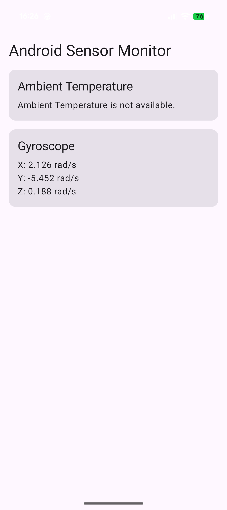

# COMP3074 LabEx 6: Reading Android Device Sensors

**Student:** Caio Cotts (101571045)
**Project:** SensorLab (`ca.gbc.comp3074.sensorlab`)

## Test device and sensor availability

| Sensor | Available on my device? | Result |
|---|---|---|
| Ambient temperature (`TYPE_AMBIENT_TEMPERATURE`) | **No** | The app shows "Ambient Temperature is not available." and does not crash |
| Gyroscope (`TYPE_GYROSCOPE`) | **Yes** | X/Y/Z angular velocity shown in rad/s. Values stay near 0 when still and change when the phone is rotated |

## Independent practice (Part 18)

I built a reusable `SensorValueCard(title, available, content)` composable. Both sensor cards use it, so the title, layout, and "not available" handling are written once. Each card passes in only the readings it shows.

## Reflection questions

1. **Why must `getDefaultSensor()` be treated as potentially returning null?**
   Android devices don't have to include every sensor. When the requested type isn't on the device, `getDefaultSensor()` returns null. Using that reference without a check would crash the app, so the sensors are stored as `Sensor?` and only used when they're present.

2. **Why should sensor listeners be unregistered when the activity is paused?**
   A paused activity isn't showing its data, so the readings it receives are wasted. A registered listener keeps the sensor hardware running and the callbacks firing, which drains the battery and uses CPU. Unregistering in `onPause()` and registering again in `onResume()` keeps the listener active only while the screen is in the foreground.

3. **What is the difference between gyroscope angular velocity and device orientation?**
   The gyroscope measures how fast the device is rotating around each axis at that moment. Orientation is the device's actual angle in space. A phone held still at any angle reads close to 0 rad/s. Getting the orientation from the gyroscope means integrating its values over time, which builds up drift, or using the rotation-vector/orientation sensors, which combine several sensors.

4. **What units are used for the gyroscope values in this lab?**
   Radians per second (rad/s) around the X, Y, and Z axes.

5. **Why is battery temperature not a valid replacement for `TYPE_AMBIENT_TEMPERATURE`?**
   Battery temperature measures the battery inside the phone. Charging, CPU load, and the user's hand all heat it up. It doesn't measure the surrounding air, so showing it as "ambient temperature" would be wrong.

6. **How does `mutableStateOf` allow a `SensorEvent` callback to update the Compose UI?**
   The values are held in snapshot state (`mutableStateOf` / `mutableFloatStateOf`). When `onSensorChanged()` writes a new value, Compose sees that the state changed and recomposes every composable that read it. The screen updates without any manual UI calls.
